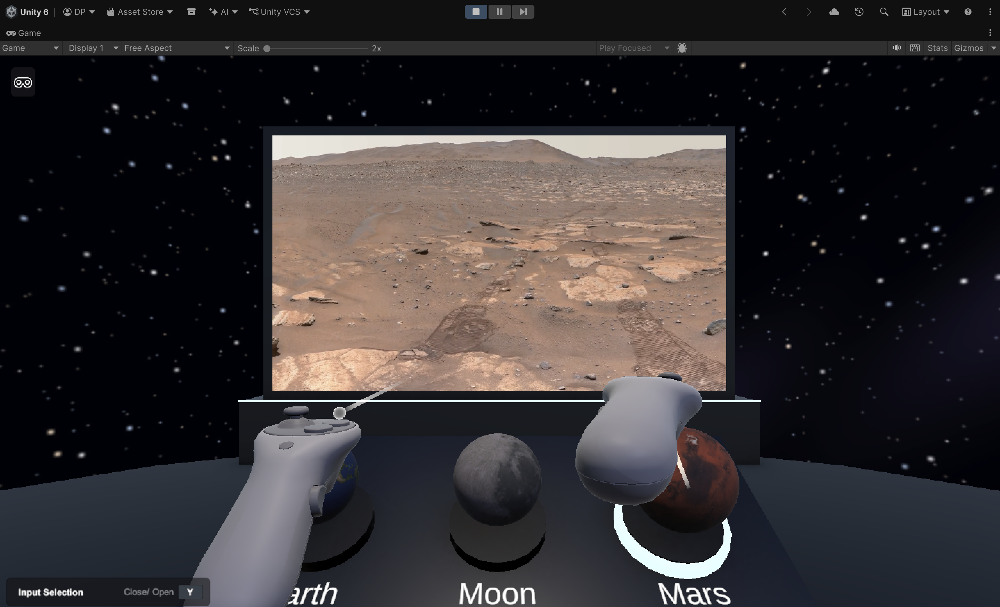
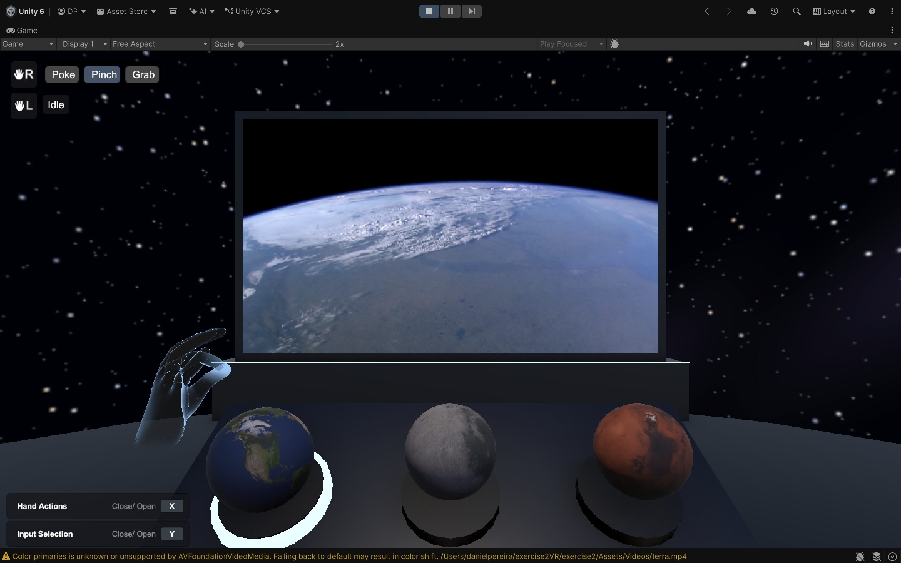

# Space Observatory – 3D UI in VR

Exercise #2 for Interactive Virtual Environments 2026-27

| Controllers | Hand tracking |
|---|---|
|  |  |

## What is implemented

A space observatory with a console and a screen. The console has three planets (Earth, Moon and Mars). Selecting a planet plays a NASA video about it on the screen.

- Each planet works as a button.
- Button states:
  - Idle: the planet is still.
  - Hover: the planet grows, rotates and plays a sound.
  - Pressed: the planet moves down and plays a click.
  - Selected: a ring appears around the base and the planet keeps rotating.
- Only one planet can be selected at a time. Selecting the same planet again pauses or resumes the video.
- The video sound comes from the screen (3D audio).
- The console light dims while a video is playing.
- Works with controllers and with hand tracking.
- Locomotion is disabled, since everything is within reach of the user.

## Requirements

- Unity 6000.6.3f1 (with Android Build Support for Meta Quest)
- Universal Render Pipeline (URP)
- XR Interaction Toolkit 3.6.1
- XR Hands
- OpenXR

## How to install and use

### Unity editor

1. Open the project in Unity Hub (Add → Add project from disk).
2. Open `Assets/Scenes/Main.unity`.
3. Press Play. The scene uses the XR Interaction Simulator (press Y to see its controls).

### Meta Quest

- Download `SpaceObservatory.apk` from [Releases](../../releases) and install it on a Quest in developer mode (Meta Quest Developer Hub or SideQuest).
- Or build it in File → Build Profiles → Meta Quest → Build.

## Controls

### Controllers

- Point the ray at a planet and press the trigger to select it.
- Select the same planet again to pause or resume the video.

### Hand tracking

- Push a planet down with the index finger (poke).
- Or point at a planet and pinch.

### Simulator

- Y: show the simulator controls.
- Mouse, W/A/S/D and Q/E: move the head or device.
- T: trigger (controllers).
- ] twice: switch the right device to a hand.
- N: poke pose. M: pinch.

## Project structure

```
Assets/
├── Scenes/Main.unity        Main scene
├── Scripts/
│   ├── PlanetButton.cs      Button states and feedback
│   └── VideoScreen.cs       Video playback and console light
├── Materials/               Materials
├── Textures/                Planet textures, sky and screen render texture
├── Videos/                  NASA videos
├── Settings/Build Profiles/ Meta Quest build profile
└── XR/                      OpenXR settings
Screenshots/                 README images
```

## Credits

- **Videos:** NASA, from the NASA Image and Video Library (images.nasa.gov). Public domain under the NASA Media Usage Guidelines.
  - Earth: [nasa.gov](https://images.nasa.gov/details/Earth%20Views%20from%20the%20International%20Space%20Station)
  - Moon – Apollo 11: [nasa.gov](https://images.nasa.gov/details/Apollo_11_moonwalk_montage_720p)
  - Mars: [nasa.gov](https://images.nasa.gov/details/JPL-20231227-M2020f-0001-Perseverance%20Rover%20Zooms%20in%20on%20Ancient%20Mars%20River)
- **Planet textures:** [Solar System Scope](https://www.solarsystemscope.com/textures/), based on NASA data, licensed under CC BY 4.0.
- **Click sound:** "Button Pop" from the XR Interaction Toolkit Starter Assets (Unity Technologies).
